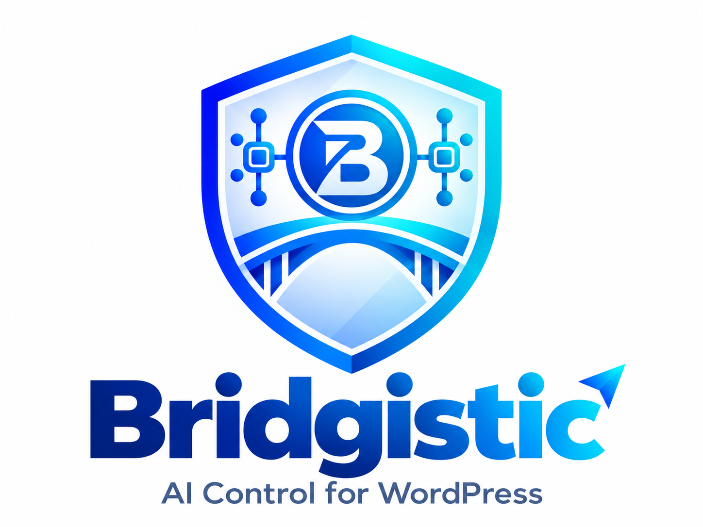

<p align="center">
  <a href="https://bridgistic.app"></a>
</p>

<p align="center"><strong>Safe AI control for WordPress over MCP: scoped keys, signed requests, human approvals, snapshots and a full audit trail.</strong></p>

<p align="center">
  <a href="https://github.com/Wordpressistic/bridgistic/releases/latest"></a>
  <a href="LICENSE"></a>
  
  
  <a href="https://www.npmjs.com/package/bridgistic-mcp-server"></a>
</p>

<p align="center">
  <a href="https://bridgistic.app">Website</a> ·
  <a href="docs/CONNECT_BRIDGISTIC.md">Connection guide</a> ·
  <a href="https://github.com/Wordpressistic/bridgistic/releases/latest">Download</a> ·
  <a href="docs/SECURITY.md">Security model</a> ·
  <a href="CHANGELOG.md">Changelog</a>
</p>

---

## What is Bridgistic?

Bridgistic lets AI assistants such as Claude, ChatGPT, OpenAI Codex, Gemini CLI, Cursor or any other [Model Context Protocol](https://modelcontextprotocol.io) client work on a real WordPress site. The assistant never gets an administrator password or a full-admin Application Password. Each connection uses its own least-privilege key. Every request is HMAC-signed and checked against that key's scopes. Risky operations can be dry-run, held for a human to approve, and snapshotted before they run.

The project has four components:

| Component | What it is | Where it lives |
| --- | --- | --- |
| **WordPress plugin** | The free bridge. It provides the REST API, keys and scopes, the Guard (dry run → approval → snapshot → execute), the audit log, snapshots, playbooks, the health check and the setup wizard. | [`wordpress-plugin/bridgistic`](wordpress-plugin/bridgistic) |
| **MCP server** | A local stdio (or Streamable HTTP) MCP server with 54 tools. It signs every call to your site. Published on npm as `bridgistic-mcp-server`. | [`mcp-server`](mcp-server) |
| **Claude integrations** | A one-click Claude Desktop extension (`bridgistic.mcpb`) and a Claude Code plugin marketplace. | [`mcpb`](mcpb), [`plugins/bridgistic`](plugins/bridgistic), [`.claude-plugin`](.claude-plugin) |
| **Bridgistic Cloud** | A hosted OAuth 2.1 + PKCE relay at `mcp.bridgistic.app` for remote-only clients such as ChatGPT. **Public beta.** | [`cloud`](cloud), [`openai-plugin`](openai-plugin) |

## Features

All of the following is in the free, GPL-licensed plugin and MCP server.

- **Scoped connection keys.** Choose a preset (Read-only → Content Manager → Safe Admin → Developer Mode) or pick individual scopes. You can rotate, revoke or delete a key at any time. A secret is shown once and stored encrypted.
- **HMAC-SHA256 request signing.** The signature covers the method, path, timestamp, nonce and body hash. Reused nonces and stale timestamps are rejected. Control parameters are accepted only inside the signed body.
- **Guard for risky actions.** Destructive operations can be dry-run first and can wait in **Bridgistic → Approvals** until a person allows them. An approval for PHP execution is bound to the hash of the exact code.
- **Snapshots and rollback.** Bridgistic captures the target before a destructive write. You can restore it from WP Admin or through MCP.
- **Audit log.** Every request is recorded with its key, action, status, source IP and time, and secrets never appear in the log (90-day retention).
- **54 MCP tools** covering posts, media, users, plugins, allow-listed options, files, the database, WooCommerce (products, orders, customers, inventory, sales summary), per-site memory, playbooks, schedules, snapshots, approvals and usage.
- **Contained developer tools.** Database, filesystem and PHP execution need Developer Mode scopes. Write SQL is classified before it runs, and executable PHP can only be written to one sandbox directory where direct web execution is blocked.
- **Playbooks and schedules.** Save reusable routines, run them on demand, or schedule them through WP-Cron (up to 3 active schedules in the free plugin).
- **Multi-site.** One local MCP server can reach several WordPress sites by alias through a shared `connections.json`. The **Multi-Site** screen builds the file for you.
- **Health Check.** Diagnostics for the REST API, permalinks, signing, clock drift, hosting firewalls and configuration, plus a debug report that contains no secrets.
- **Ready-made client configs.** The **AI / MCP Connections** wizard and **Export Package** generate configs for Claude Desktop, Claude Code, Codex CLI, Gemini CLI and generic MCP clients.

## Quick start

**Requirements:** WordPress 6.4+ and PHP 8.0+ on HTTPS, with permalinks set to anything except "Plain". Node.js 20+ is only needed for the npm/stdio server. The Claude Desktop extension and Bridgistic Cloud don't need it.

### 1. Install the WordPress plugin

1. Download `bridgistic-wordpress-plugin.zip` from the [latest release](https://github.com/Wordpressistic/bridgistic/releases/latest).
2. In WordPress, go to **Plugins → Add New → Upload Plugin**, then upload and activate the zip.
3. Open **Bridgistic → AI / MCP Connections**, choose your client, and create a **Read-only** key to begin with. Copy the Key ID (`wpk_…`) and the Secret (`wps_…`). The secret is shown only once.

### 2. Connect your AI client

<details open>
<summary><strong>Claude Desktop: one-click extension (no terminal, no Node.js)</strong></summary>

1. Download `bridgistic.mcpb` from the [latest release](https://github.com/Wordpressistic/bridgistic/releases/latest).
2. Double-click it. When Claude Desktop prompts you, enter your WordPress site URL, the Key ID and the Secret.
3. Ask Claude: *"Run bridgistic_get_site_info"*.

Details: [docs/CLAUDE_DESKTOP.md](docs/CLAUDE_DESKTOP.md)
</details>

<details>
<summary><strong>Claude Code: plugin marketplace</strong></summary>

```text
/plugin marketplace add wordpressistic/bridgistic
/plugin install bridgistic@bridgistic-marketplace
```

```bash
export BRIDGISTIC_SITE_URL="https://example.com"
export BRIDGISTIC_KEY_ID="wpk_..."
export BRIDGISTIC_KEY_SECRET="wps_..."
```

Details: [docs/CLAUDE_CODE.md](docs/CLAUDE_CODE.md)
</details>

<details>
<summary><strong>OpenAI Codex CLI, Gemini CLI and other local MCP clients: npx</strong></summary>

```toml
# ~/.codex/config.toml
[mcp_servers.bridgistic]
command = "npx"
args = ["-y", "bridgistic-mcp-server"]
env = { BRIDGISTIC_SITE_URL = "https://example.com", BRIDGISTIC_KEY_ID = "wpk_...", BRIDGISTIC_KEY_SECRET = "wps_..." }
```

Details: [docs/CODEX_SETUP.md](docs/CODEX_SETUP.md) · [docs/GEMINI_SETUP.md](docs/GEMINI_SETUP.md) · [docs/CONNECT_OTHER_AI.md](docs/CONNECT_OTHER_AI.md)
</details>

<details>
<summary><strong>ChatGPT and remote-only clients: Bridgistic Cloud (public beta)</strong></summary>

Open **WP Admin → Bridgistic → Bridgistic Cloud**, copy the MCP URL into your client's connector settings, and approve the WordPress consent screen. Bridgistic Cloud has not yet had an independent security review, so prefer the local connection wherever your client supports it.

Details: [docs/CHATGPT_SETUP.md](docs/CHATGPT_SETUP.md) · [docs/CLOUD_CONNECTOR.md](docs/CLOUD_CONNECTOR.md)
</details>

### 3. Verify

Ask your assistant to run `bridgistic_get_site_info`, then open **Bridgistic → Logs** to see the request. If something doesn't work, run **Bridgistic → Health Check** first. The full walkthrough and troubleshooting are in [docs/CONNECT_BRIDGISTIC.md](docs/CONNECT_BRIDGISTIC.md).

## Free and Pro

The plugin download is free and open source, and the plugin never gates its bridge or security features behind a license. Bridgistic Pro is sold on [bridgistic.app](https://bridgistic.app), billed through Paddle (Merchant of Record).

| | Free | Pro: Lifetime Deal (welcome offer) | Pro: monthly / yearly |
| --- | --- | --- | --- |
| Price | $0 | **$49.99 one time.** Offered until 31 December 2026, 100 licenses only. | **$12 / month** or **$99 / year** |
| Licenses · sites | — | 1 license · 1 site | 1 license · 5 sites |
| Full local bridge: scoped keys, HMAC signing, approvals, snapshots, audit log, 54 MCP tools | ✅ | ✅ | ✅ |
| Playbooks and schedules | ✅ (up to 3 active schedules) | ✅ | ✅ |
| Bridgistic dashboard at `dashboard.bridgistic.app` | — | ✅ | ✅ |
| Updates | GitHub releases | All future updates | While the plan is active |
| Unlimited schedules, snapshots past 50, audit log export, skills marketplace, agency dashboard, team permissions | — | Included with a live license. Later app updates included | Included with a live license. Later app updates included |
| White-label, Cloud Agent credits | — | Not included | Not included |

Prices are in USD and taxes are calculated at checkout. Every purchase has a 7-day refund guarantee. The current offer and terms are on [bridgistic.app](https://bridgistic.app): [Terms](https://bridgistic.app/terms), [Privacy](https://bridgistic.app/privacy), [Refund policy](https://bridgistic.app/refund-policy), [How purchases work](https://bridgistic.app/how-purchases-work).

## Documentation

| Topic | Link |
| --- | --- |
| Complete connection guide | [docs/CONNECT_BRIDGISTIC.md](docs/CONNECT_BRIDGISTIC.md) |
| Install (all components) | [docs/INSTALL.md](docs/INSTALL.md) |
| WordPress setup | [docs/WORDPRESS_SETUP.md](docs/WORDPRESS_SETUP.md) |
| Claude Desktop · Claude Code | [docs/CLAUDE_DESKTOP.md](docs/CLAUDE_DESKTOP.md) · [docs/CLAUDE_CODE.md](docs/CLAUDE_CODE.md) |
| Codex CLI · Gemini CLI · ChatGPT | [docs/CODEX_SETUP.md](docs/CODEX_SETUP.md) · [docs/GEMINI_SETUP.md](docs/GEMINI_SETUP.md) · [docs/CHATGPT_SETUP.md](docs/CHATGPT_SETUP.md) |
| Other MCP clients and multi-site | [docs/CONNECT_OTHER_AI.md](docs/CONNECT_OTHER_AI.md) |
| Bridgistic Cloud (beta) | [docs/CLOUD_CONNECTOR.md](docs/CLOUD_CONNECTOR.md) |
| Security model | [docs/SECURITY.md](docs/SECURITY.md) |
| Free vs Pro, from the code | [docs/FEATURE-MATRIX.md](docs/FEATURE-MATRIX.md) |
| Account dashboard and platform admin | [docs/CONTROL-PLANE.md](docs/CONTROL-PLANE.md) |
| Public site SEO, sitemap and llms.txt | [docs/SEO.md](docs/SEO.md) |
| Privacy | [docs/PRIVACY.md](docs/PRIVACY.md) |
| Testing | [docs/TESTING.md](docs/TESTING.md) |
| Releasing | [docs/RELEASING.md](docs/RELEASING.md) |
| Repositories | [docs/REPO-STRUCTURE.md](docs/REPO-STRUCTURE.md) |
| Roadmap | [docs/ROADMAP.md](docs/ROADMAP.md) |

## Repository layout

```text
wordpress-plugin/bridgistic/   WordPress plugin (PHP) and its test suites
mcp-server/                    MCP server (TypeScript), npm package bridgistic-mcp-server
plugins/bridgistic/            Claude Code plugin: bundled server, example configs, install scripts
.claude-plugin/                Claude Code marketplace manifest
mcpb/                          Claude Desktop extension manifest and icon
cloud/                         Bridgistic Cloud: Cloudflare Worker OAuth relay
openai-plugin/                 OpenAI / ChatGPT agent-plugin package
scripts/                       Build, package, verification and release scripts
release/                       Per-version release notes, test reports and security checklists
index.html, functions/, *.html Website at bridgistic.app (Cloudflare Pages)
```

Official Claude and plugin-marketplace listings are published from [Wordpressistic/bridgistic-claude-marketplace](https://github.com/Wordpressistic/bridgistic-claude-marketplace). Each release there is synced from this repository.

## Development

```bash
npm run bootstrap   # install mcp-server and cloud dependencies
npm run build       # compile the MCP server and refresh the bundled Claude plugin server
npm run test:all    # MCP contract and integration tests, PHP suites, cloud tests, bundle smoke test
npm run lint:php    # php -l across the plugin
npm run validate    # manifests, version consistency and secret scan
npm run release     # build every release artifact into dist/release-v<version>/
```

Please read [CONTRIBUTING.md](CONTRIBUTING.md) before opening a pull request.

## Security

Please don't report vulnerabilities in public issues. Email **hello@insightistic.com**, or use GitHub's private vulnerability reporting. See [SECURITY.md](SECURITY.md).

## Support

- Questions and bugs: [GitHub issues](https://github.com/Wordpressistic/bridgistic/issues)
- Purchases, licenses and refunds: support@wpistic.com (see [How purchases work](https://bridgistic.app/how-purchases-work))
- General enquiries: hello@insightistic.com

## License

Bridgistic is free software released under the [GNU General Public License v2.0 or later](LICENSE).

---

<p align="center">
  Built by <strong>WordPressistic LLC</strong>, 1209 Mountain Road PL NE, STE N, Albuquerque, NM 87110, United States<br>
  <a href="https://bridgistic.app">bridgistic.app</a> ·
  <a href="https://github.com/wordpressistic">GitHub</a> ·
  <a href="https://x.com/wordpressistic">X</a> ·
  <a href="https://www.linkedin.com/company/wordpressistic">LinkedIn</a> ·
  <a href="https://www.youtube.com/@wordpressistic">YouTube</a>
</p>
